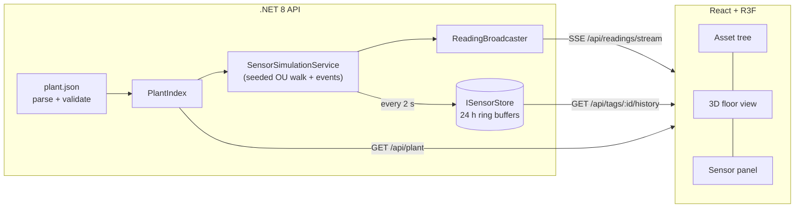

# SensorMind

**Industrial IoT sensor intelligence platform.** SensorMind shows a 3D plant view where clicking an asset brings up its live sensor tags. Alongside it (from Phase 2) is a RAG assistant that answers questions about plant state, recent readings and equipment manuals, with citations.

Built with .NET 8, React 19, Three.js and Qdrant. MIT licensed.


## Status

| Phase | Scope | State |
|-------|-------|-------|
| 1. Skeleton | Plant config loader and validation, asset tree, 3D floor view with selection, simulated sensor stream, live sensor panel | ✅ Done |
| 2. RAG | PDF ingestion, Qdrant, OpenRouter embeddings, streaming chat with citations | In progress: Qdrant vector store done |
| 3. Intelligence | Selected-asset context, live readings in prompts, chart tool calling with inline Recharts | Planned |
| 4. Hardening | Rate limiting, bring-your-own key, CI, GitHub Pages and Render deploys | Planned |

## Run it

Needs the .NET 8 SDK, Node 20+ and Docker (for PostgreSQL and Qdrant):

```bash
# once: start PostgreSQL and Qdrant in the background
docker compose up -d

# terminal 1: API on http://localhost:5080 (Development: fixed seed, CORS for :5173)
dotnet run --project backend/SensorMind.Api

# terminal 2: UI on http://localhost:5173 (proxies /api to :5080)
cd frontend && npm install && npm run dev
```

**Sign in:** users are stored in PostgreSQL. A `guest` / `guest` user is created on first run, and the login page has a **Login as Guest** button that fills in those credentials.

## How it works



- **Plant config** ([format](docs/plant-config.md)): a JSON file with the hierarchy Site → Floor → Group → Equipment → Tags. The parser validates it in a single pass and reports every error with a JSON path. The API won't start on an invalid file.
- **Simulation:** each tag follows a mean-reverting random walk around its nominal band. Occasional drifts, spikes and rare alarm excursions are layered on top. The simulator is deterministic for a given seed. History is backfilled at startup, so charts have data straight away.
- **Storage:** a fixed-size ring buffer per tag behind `ISensorStore`, so a historian or TSDB can replace it later.
- **Live data:** Server-Sent Events. Each client gets a bounded buffer, so a slow consumer never blocks the others.
- **UI:** design tokens are CSS variables shared by Tailwind and the Three.js scene, and are WCAG AA checked. Status shows as an emissive tint on equipment and as labelled badges in the panels.

Design choices and trade-offs are logged in [docs/decisions.md](docs/decisions.md).

## API

| Method | Path | Description |
|--------|------|-------------|
| GET | `/api/plant` | The validated plant model |
| POST | `/api/plant/validate` | Validate a candidate plant file (body: the JSON). Returns `{ valid, errors[], summary }` |
| GET | `/api/readings/latest` | Latest reading per tag |
| GET | `/api/readings/stream` | SSE: a `readings` event on connect, then one per sample tick |
| GET | `/api/tags/{tagId}/history?from&to&maxPoints` | Downsampled history (defaults: last hour, 300 points) |
| GET | `/health` | Liveness |

[`backend/SensorMind.Api/SensorMind.Api.http`](backend/SensorMind.Api/SensorMind.Api.http) has ready-to-run requests.

## Configuration

| Setting (env var) | Default | |
|---|---|---|
| `ConnectionStrings__SensorMind` | none (Development: the local Docker database) | PostgreSQL connection string |
| `Plant__ConfigPath` | `data/plant.sample.json` | Relative to the API content root. Seeds the Demo Tenant when the database is empty |
| `Qdrant__Url` | none (Development: `http://localhost:6334`) | Qdrant gRPC endpoint (local container or Qdrant Cloud) |
| `Qdrant__ApiKey` | none | Qdrant Cloud API key |
| `Qdrant__Collection` | `manuals` | Collection for manual chunks |
| `Qdrant__VectorSize` | `1536` | Must match the embedding model |
| `Simulation__Seed` | random (Development: 42) | Fix it for reproducible data |
| `Simulation__IntervalSeconds` | `2` | Sample period |
| `Simulation__RetentionHours` | `24` | In-memory history window |
| `Simulation__BackfillHours` | `24` | History generated at startup |
| `Cors__AllowedOrigins__0` | none (Development: `http://localhost:5173`) | Frontend origin(s) |
| `VITE_API_BASE_URL` (frontend build) | empty, uses the same origin | Deployed API URL |

See [`frontend/.env.example`](frontend/.env.example).

## Repository layout

```
backend/
  SensorMind.Api             Minimal API endpoints, SSE, CORS, hosting
  SensorMind.Core            Domain model, config parser/validator, simulator, abstractions (no IO)
  SensorMind.Infrastructure  PostgreSQL (tenants, sites, users), Qdrant vector store, in-memory store, live feed, simulation service
frontend/                    React 19 + TypeScript + Vite, @react-three/fiber, Recharts, Tailwind v4
data/plant.sample.json       2 floors, 10 assets (Grundfos, Atlas Copco, ABB), 36 tags
data/manuals/                Equipment manual PDFs for RAG (Phase 2)
docs/                        Decisions, config reference, original spec
```

## License

[MIT](LICENSE)
