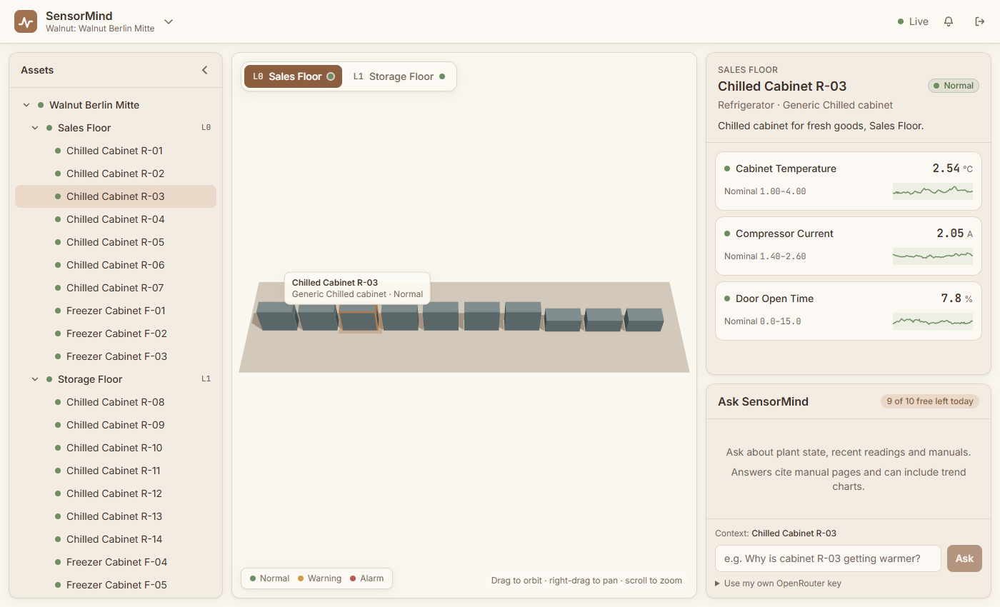
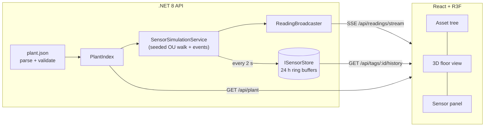

# SensorMind

**Industrial IoT sensor intelligence platform.** SensorMind shows a 3D plant view where clicking an asset brings up its live sensor tags. Alongside it (from Phase 2) is a RAG assistant that answers questions about plant state, recent readings and asset manuals, with citations.

Built with .NET 8, React 19, Three.js and Qdrant. MIT licensed.



## Status

| Phase | Scope | State |
|-------|-------|-------|
| 1. Skeleton | Plant config loader and validation, asset tree, 3D floor view with selection, simulated sensor stream, live sensor panel | ✅ Done |
| 2. RAG | PDF ingestion, Qdrant, OpenRouter embeddings, streaming chat with citations | Done (needs an OpenRouter key to run) |
| 3. Intelligence | Selected-asset context, live readings in prompts, chart tool calling with inline Recharts | Planned |
| 4. Hardening | Rate limiting, bring-your-own key, CI, GitHub Pages and Render deploys | Planned |

## Run it

Needs the .NET 8 SDK, Node 20+ and Docker (for PostgreSQL and Qdrant):

```bash
# once: start PostgreSQL and Qdrant in the background
docker compose up -d

# terminal 1: API on http://localhost:5080 (Development: fixed seed, CORS for :5173)
dotnet run --project backend/SensorMind.Api

# terminal 2: UI on http://localhost:5173 (proxies /api to :5080)
cd frontend && npm install && npm run dev
```

**Sign in:** users are stored in PostgreSQL. A `guest` / `guest` user is created on first run, and the login page has a **Login as Guest** button that fills in those credentials.

## How it works



- **Plant config** ([format](docs/plant-config.md)): a JSON file with the hierarchy Site → Floor → Asset → Tag. The parser validates it in a single pass and reports every error with a JSON path. The API won't start on an invalid file.
- **Simulation:** each tag follows a mean-reverting random walk around its nominal band. Occasional drifts, spikes and rare alarm excursions are layered on top. The simulator is deterministic for a given seed. History is backfilled at startup, so charts have data straight away.
- **RAG:** at startup the PDFs in `data/manuals` are split per page into overlapping chunks (about 450 words), embedded through OpenRouter and stored in Qdrant with source file, page, document hash and, when the file name names an asset of the plant, manufacturer and model. A document whose hash is already stored is skipped. A question is embedded, the top 5 chunks are retrieved (filtered by the selected asset's manufacturer, widened if nothing matches), and the prompt adds live readings with a 15-minute trend for the relevant assets. The answer streams over SSE, cites excerpts by number, and may ask for a trend graph with a fenced `chart` block that the API validates against the plant's tags. Users get 10 free questions per address per day, or unlimited use with their own key in the `X-OpenRouter-Key` header (not logged or stored).
- **Storage:** a fixed-size ring buffer per tag behind `ISensorStore`, so a historian or TSDB can replace it later.
- **Live data:** Server-Sent Events. Each client gets a bounded buffer, so a slow consumer never blocks the others.
- **UI:** design tokens are CSS variables shared by Tailwind and the Three.js scene, and are WCAG AA checked. Status shows as an emissive tint on assets and as labelled badges in the panels.

Design choices and trade-offs are logged in [docs/decisions.md](docs/decisions.md).

## API

| Method | Path | Description |
|--------|------|-------------|
| GET | `/api/plant` | The validated plant model |
| POST | `/api/plant/validate` | Validate a candidate plant file (body: the JSON). Returns `{ valid, errors[], summary }` |
| GET | `/api/readings/latest` | Latest reading per tag |
| GET | `/api/readings/stream` | SSE: a `readings` event on connect, then one per sample tick |
| GET | `/api/tags/{tagId}/history?from&to&maxPoints` | Downsampled history (defaults: last hour, 300 points) |
| POST | `/api/chat` | SSE answer to `{ question, assetId?, history? }`: `token`, `citations`, `chart`, `done` or `error` events. Optional `X-OpenRouter-Key` header |
| GET | `/api/chat/status` | `{ configured, limit, remaining }` for the caller's address |
| GET | `/health` | Liveness |

**Swagger UI** (Development only): http://localhost:5080/swagger, JSON at `/swagger/v1/swagger.json`. To call protected endpoints, run `POST /api/auth/login` with `{"username":"guest","password":"guest"}`, copy the `token`, click **Authorize** and paste it. The streaming endpoints (`/api/chat`, `/api/readings/stream`) are listed but Swagger UI cannot show them live.

**Errors and request log:** an unhandled exception returns a generic `500` problem response (no details); the UI shows failures as toasts with fixed friendly messages. Every 4xx/5xx response and every successful login, tenant create/edit/delete and chat request is stored in the `logs` table (`id`, `timestamp_utc`, `type` SUCCESS/FAILURE, `status_code`, `method`, `path`, `logged_in_user`, `error_message`). Live feed, history and other successful reads are not logged, and bodies, passwords, tokens, keys and chat questions never are. View it with SQL, e.g. `select * from logs order by id desc limit 50;`.

[`backend/SensorMind.Api/SensorMind.Api.http`](backend/SensorMind.Api/SensorMind.Api.http) has ready-to-run requests.

## Configuration

| Setting (env var) | Default | |
|---|---|---|
| `ConnectionStrings__SensorMind` | none (Development: the local Docker database) | PostgreSQL connection string |
| `Plant__ConfigPath` | `data/plant.sample.json` | Relative to the API content root. Seeds the Walnut tenant when the database is empty |
| `Qdrant__Url` | none (Development: `http://localhost:6334`) | Qdrant gRPC endpoint (local container or Qdrant Cloud) |
| `Qdrant__ApiKey` | none | Qdrant Cloud API key |
| `Qdrant__Collection` | `manuals` | Collection for manual chunks |
| `Qdrant__VectorSize` | `1536` | Must match the embedding model |
| `OpenRouter__ApiKey` | none | Server-side OpenRouter key. Without it, ingestion is skipped and chat asks for the user's own key |
| `OpenRouter__BaseUrl` | `https://openrouter.ai/api/v1` | Any OpenAI-compatible endpoint |
| `OpenRouter__EmbeddingModel` | `openai/text-embedding-3-small` | Output size must equal `Qdrant__VectorSize` |
| `OpenRouter__ChatModel` | `openai/gpt-4o-mini` | Model for answers |
| `Manuals__Path` | `data/manuals` | PDF folder, relative to the API content root (Development: `../../data/manuals`) |
| `Chat__FreeQueriesPerDay` | `10` | Free questions per client address per UTC day (in memory) |
| `Simulation__Seed` | random (Development: 42) | Fix it for reproducible data |
| `Simulation__IntervalSeconds` | `2` | Sample period |
| `Simulation__RetentionHours` | `24` | In-memory history window |
| `Simulation__BackfillHours` | `24` | History generated at startup |
| `Cors__AllowedOrigins__0` | none (Development: `http://localhost:5173`) | Frontend origin(s) |
| `VITE_API_BASE_URL` (frontend build) | empty, uses the same origin | Deployed API URL |

See [`frontend/.env.example`](frontend/.env.example).

## Repository layout

```
backend/
  SensorMind.Api             API controllers, SSE, CORS, hosting
  SensorMind.Core            Domain model, config parser/validator, simulator, repository interfaces (no IO)
  SensorMind.Infrastructure  EF Core repositories and migrations (PostgreSQL: tenants, sites, users), Qdrant vector store, in-memory store, live feed, simulation service
frontend/                    React 19 + TypeScript + Vite, @react-three/fiber, Recharts, Tailwind v4
data/plant.sample.json       Walnut Berlin Mitte: 2 floors, 20 refrigerators, 60 tags
data/manuals/                Asset manual PDFs for RAG (one fictional demo manual is included)
docs/                        Decisions, config reference, original spec
```

## License

[MIT](LICENSE)
