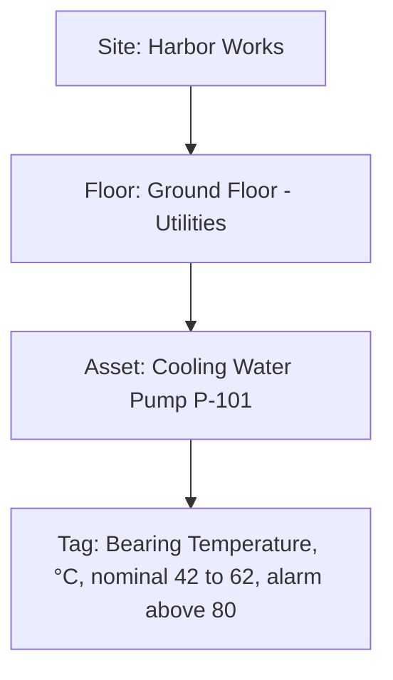

# Plant configuration format

A plant is one JSON file: **Site → Floors → Assets → Tags**. The API loads it at startup from `Plant:ConfigPath` (env `Plant__ConfigPath`) when the database is empty, and the same format is used for the sites stored per tenant. If the file is invalid, the API refuses to start and lists every error. [`data/plant.sample.json`](../data/plant.sample.json) is a complete example.

## The four levels

| Level | Meaning in SensorMind | Example |
|-------|-----------------------|---------|
| **Site** | The plant as a whole. | Harbor Works |
| **Floor** | One level of the building, drawn in its own 3D view. | Ground Floor - Utilities |
| **Asset** | A machine you monitor, such as a pump or compressor. It is the unit you select in the tree or the 3D view, and the one you ask the assistant about. | Cooling Water Pump P-101 |
| **Tag** | One sensor signal on an asset, with a unit and nominal and alarm limits. | Bearing Temperature (°C) |



To check a file without restarting the API:

```bash
curl -X POST http://localhost:5080/api/plant/validate \
  -H "Content-Type: application/json" --data-binary @my-plant.json
```

```json
{ "valid": false, "errors": [
  { "path": "$.site.floors[0].assets[1].tags[2].alarmHigh", "message": "Must be above nominalMax (62)." }
] }
```

## Shape

```jsonc
{
  "schemaVersion": 1,                       // optional, defaults to 1
  "site": {
    "id": "site-harbor", "name": "Harbor Works", "location": "optional",
    "floors": [{
      "id": "floor-ground", "name": "Ground Floor", "level": 0,
      "size": { "width": 30, "depth": 18 },  // metres
      "assets": [{
        "id": "p-101", "name": "Cooling Water Pump P-101",
        "type": "pump", "manufacturer": "Grundfos", "model": "CR 32-2",
        "description": "optional",
        "position": { "x": 5, "z": 5 },    // footprint centre from the floor corner; optional "y" = base elevation
        "size": { "x": 0.7, "y": 1.5, "z": 0.7 },
        "rotation": 0,                     // optional, degrees around the vertical axis
        "shape": "cylinder",               // optional, defaults by type
        "tags": [{
          "id": "p-101.bearing-temp", "name": "Bearing Temperature", "unit": "°C",
          "nominalMin": 42, "nominalMax": 62,
          "alarmHigh": 80                  // optional; alarmLow likewise
        }]
      }]
    }]
  }
}
```

## Rules

- **Ids** are lowercase letters and digits separated by `-`, `_` or `.`. They must be unique across the whole plant for each kind (floors, assets, tags).
- **Floor `level`** must be unique.
- **`type`** is one of `pump`, `compressor`, `motor`, `tank`, `fan`, `valve`, `heat-exchanger`, `other`.
- **`shape`** is one of `box`, `cylinder`, `horizontal-cylinder`, `sphere`. The default is a horizontal cylinder for pumps, motors and heat exchangers, a cylinder for tanks and fans, a sphere for valves, and a box otherwise.
- **Sizes** must be greater than 0. The rotated footprint must fit inside the floor.
- **Tags:** `nominalMin < nominalMax`. If set, `alarmLow < nominalMin` and `alarmHigh > nominalMax`.
- **Status:** inside the nominal band is *normal*, outside it is *warning*, and at or beyond an alarm limit is *alarm*.
- **Unknown properties are rejected** so that typos surface. Comments and trailing commas are allowed.

## Stored sites from before the Floor > Asset change

Earlier versions stored `floors[].groups[].equipment[]`. The API now stops at startup with an error that names the site if a stored row still has that shape. Convert the rows once on your own database (back it up first); the statement does nothing to rows that are already converted:

```sql
UPDATE sites s SET config_json = (
  SELECT jsonb_set(
    s.config_json::jsonb, '{site,floors}',
    COALESCE(jsonb_agg(
      CASE WHEN f.fl ? 'groups'
        THEN (f.fl - 'groups') || jsonb_build_object('assets', COALESCE((
               SELECT jsonb_agg(a.asset ORDER BY g.gi, a.ai)
               FROM jsonb_array_elements(f.fl -> 'groups') WITH ORDINALITY AS g(grp, gi),
                    jsonb_array_elements(g.grp -> 'equipment') WITH ORDINALITY AS a(asset, ai)
             ), '[]'::jsonb))
        ELSE f.fl END
      ORDER BY f.fi), '[]'::jsonb))::text
  FROM jsonb_array_elements(s.config_json::jsonb #> '{site,floors}') WITH ORDINALITY AS f(fl, fi)
)
WHERE s.config_json::jsonb #> '{site,floors}' @? '$[*].groups';
```

For the Docker database in `docker-compose.yml`, save the statement as `convert.sql` and run `docker compose exec -T postgres psql -U sensormind -d sensormind < convert.sql`. Group names are dropped; assets keep their order. A fresh database is seeded from the new sample and needs nothing.
